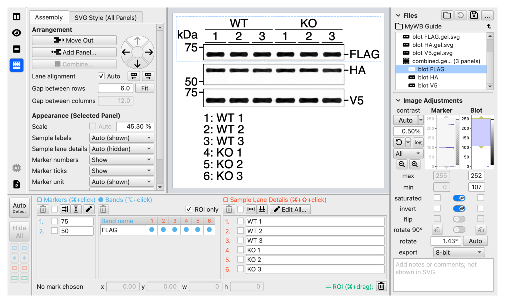
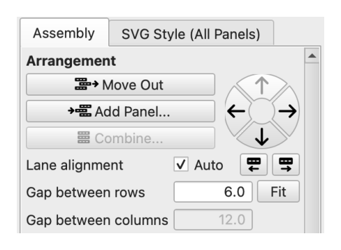
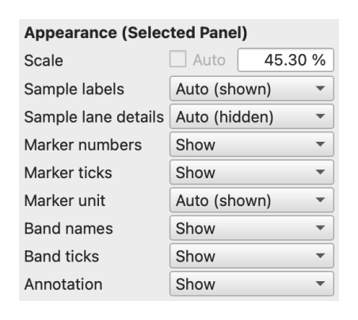

# Put panels together as an assembly

[← How to use MyWB](../user-guide.md)

Use **Assembly View** to combine panels into a grid and adjust their layout. Each panel keeps its own images, ROI, labels and bands.

## Make an assembly

Save each [figure](from-blot-to-figure.md) as a `.gel.svg` file in the same folder.

1. In the **Files** panel on the right side of the window, select the files to put together: click the first, then <kbd>Command</kbd>-click (macOS) or <kbd>Ctrl</kbd>-click (Windows) the others.
2. In **Assembly View**, click <picture><source media="(prefers-color-scheme: dark)" srcset="../assets/assembly-stack_gray20.svg"></picture> **Combine...** under **Arrangement** in the **Assembly** tab on the left. In other views, use **Combine...** on the selection card.
3. When prompted, enter a file name and click **Combine**.

MyWB saves and opens a new `.gel.svg` beside the first file, with panels in the order shown in **Files**. If the selection already contains an assembly, the other files are added to the topmost selected assembly instead.

> [!NOTE]
> Files merged into the assembly move to the Trash and lose their undo history.

## Open an assembly

The **Files** panel lists an assembly as `name (N panels)`. Expand it and click a panel to edit its images, ROI and labels.

To see the whole assembly, click <picture><source media="(prefers-color-scheme: dark)" srcset="../assets/assembly-stack_gray20.svg"></picture> **Assembly View** in the left sidebar.

To name a panel, choose **Rename** on its row in **Files**.

## Arrange the panels

Use **Arrangement** in the **Assembly** tab on the left. Click a panel in the figure to select it.

- <picture><source media="(prefers-color-scheme: dark)" srcset="../assets/panel-move-out_gray20.svg"></picture> **Move Out** takes the selected panels out of the assembly. Panels already saved in it are written to separate files beside it.
- <picture><source media="(prefers-color-scheme: dark)" srcset="../assets/panel-add_gray20.svg"></picture> **Add Panel...** adds copies of single-panel MyWB files below the selected panel, keeping the original files.
- <picture><source media="(prefers-color-scheme: dark)" srcset="../assets/assembly-stack_gray20.svg"></picture> **Combine...** merges two or more MyWB files selected in **Files** into one assembly. See [Make an assembly](#make-an-assembly) for the steps.

Moving out saved panels writes files immediately and cannot be undone in MyWB. If only one panel remains, it is saved separately too. The assembly file moves to the Trash when it contains no other panels.

To adjust the layout:

- **Move a panel:** use the arrow pad or arrow keys to move it one grid cell. Occupied cells swap panels.
- **Gap between rows** and **Gap between columns** set the space between the panels. **Fit** beside **Gap between rows** sets it to the smallest gap at which nothing the rows draw touches, the marker numbers included, with a little room between.
- **Lane alignment:** **Auto** aligns matching lanes across panels. Use its left and right arrows for a manual offset.
- **Copy Lanes from Above** copies sample lanes from the panel above when the selected panel has none.

## Set how each panel looks

**Appearance** controls the selected panel's size and which labels it shows.

- **Scale:** set the size yourself, or use **Auto** to match lane spacing (image width when there are fewer than two sample lanes).
- Set labels, ticks, marker units, band names and annotations to **Show** or **Hide**. **Auto** hides repeated sample labels, lane details and marker units.

Select several panels in **Files** to apply these settings together, or the assembly's file row to apply them to all panels.

## Change the style of every panel

The **SVG Style (All Panels)** tab changes every panel's [SVG style](design-and-preview-figure.md#edit-svg-style). Blank fields mean the panels have different values.

For one panel, select it and click **Edit in SVG Preview**.

## Apply image adjustments to multiple panels

1. Open the assembly in <picture><source media="(prefers-color-scheme: dark)" srcset="../assets/assembly-stack_gray20.svg"></picture> **Assembly View**.
2. In **Files**, select a panel, then <kbd>Command</kbd>-click (macOS) or <kbd>Ctrl</kbd>-click (Windows) other panels of the same assembly. To adjust every panel, select the assembly's file row.
3. Use **Image Adjustments** to change the selected panels' Blot contrast, inversion, saturation highlighting, fine rotation angle, or export bit depth.

Blank fields or a dash indicate that the panels have different values. Changing a setting applies it to the selected panels; other settings keep their individual values.

Use **Edit > Undo** in **Assembly View** to undo a shared adjustment across the affected panels. After changing the rotation angle, check each panel's ROI.

> [!NOTE]
> Shared contrast adjustment requires single-channel blot images with the same bit depth and **invert** setting. Otherwise, adjust each panel separately.

## Save the assembly

**Save** updates the existing file. In Assembly View, **Save As** saves the assembly to a new file. Layout and style changes can be undone with **Edit > Undo**.

## Continue with

- [Edit SVG style](design-and-preview-figure.md#edit-svg-style)
- [Manage MyWB files](manage-mywb-files.md#use-the-files-panel)
- [Copy the figure to PowerPoint](powerpoint-workflow.md#powerpoint-workflow)
