# Preview, layout, and style of the figure

[← How to use MyWB](../user-guide.md)

Use the live SVG Preview to arrange labels and adjust the figure's appearance.

## Before you start

1. Click <picture><source media="(prefers-color-scheme: dark)" srcset="../assets/table-columns-solid_gray20.svg"></picture> **Marker/blot view** in the left sidebar.
2. [Open a blot image](open-images.md).
3. [Open a marker image](open-images.md) if you want to compare or transform both images.
4. [Adjust marker and blot images](adjust-images.md) if necessary.
5. Add [marker positions](edit-roi-and-labels.md#add-marker-and-sample-positions) and [sample positions](edit-roi-and-labels.md#add-marker-and-sample-positions).

## Preview of the figure

Click <picture><source media="(prefers-color-scheme: dark)" srcset="../assets/eye-solid_gray20.svg"></picture> **SVG Preview** in the left sidebar to check the live figure preview. It uses the ROI when one exists and the full blot otherwise.

- Use the **Sample Label** tab on the left to edit sample-label layout and content.
- Figure appearance can be edited on the **SVG Style** tab under **Global**, **Image**, **Markers**, **Marker Unit**, **Bands**, **Labels**, **Details**, and **Annotation**.
- Click a part of the preview to bring up the setting that changes it. See [Find a setting from the preview](#find-a-setting-from-the-preview).

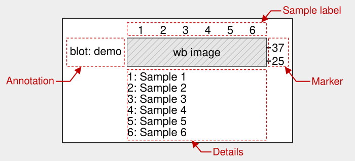

## Edit sample labels

You can select a **Layout** in the **Sample Label** tab when at least one applicable [Sample position](edit-roi-and-labels.md#add-marker-and-sample-positions) is available. With an ROI, only Sample positions within the ROI's horizontal range are used; without an ROI, all Sample positions are used with the full blot.

<table>
  <tr>
    <td valign="top" width="50%">
      
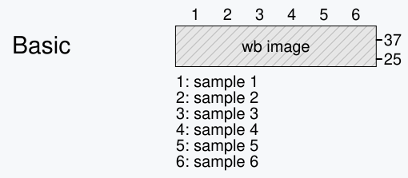

      
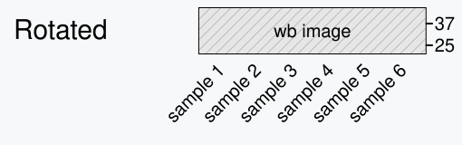

    </td>
    <td valign="top" width="50%">
      
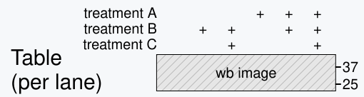

      
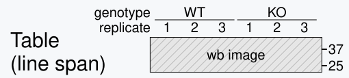

      
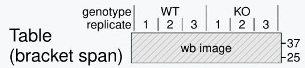

    </td>
  </tr>
</table>

### Edit table layout

When you select a table-based layout, the table editing area appears.

- Use the <picture><source media="(prefers-color-scheme: dark)" srcset="../assets/plus-solid_gray20.svg"></picture> **Add**, <picture><source media="(prefers-color-scheme: dark)" srcset="../assets/arrow-up-solid_gray20.svg"></picture> **Up**, <picture><source media="(prefers-color-scheme: dark)" srcset="../assets/arrow-down-solid_gray20.svg"></picture> **Down**, and <picture><source media="(prefers-color-scheme: dark)" srcset="../assets/trash-can-regular_gray20.svg"></picture> **Trash** buttons to add, move, or delete rows.
- Use the <picture><source media="(prefers-color-scheme: dark)" srcset="../assets/align-right-solid_gray20.svg"></picture> **Row header alignment** button to cycle row headers through right, center, and left alignment. The icon indicates the current alignment.
- For the **Table (per lane)** layout, the text entered in each table cell is used directly as the label.
- For the **Table (line span)** and **Table (bracket span)** layouts, adjacent cells containing the same text are merged and displayed as a single label.
- Move the **Separator** up or down to place table rows above and below the blot.
- Click the <picture><source media="(prefers-color-scheme: dark)" srcset="../assets/gear-solid_gray20.svg"></picture> **Settings** button to configure row-specific settings.
- Additional style settings are available as shown below.

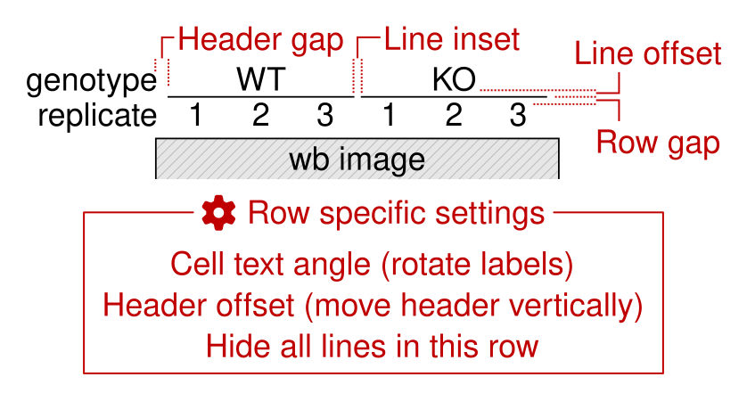

Below are several examples of table layouts.

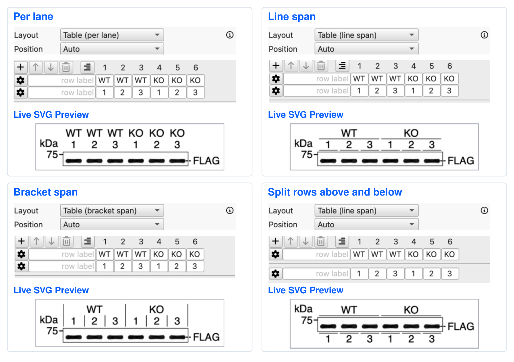

### Edit rotated layout

- Enter a value in **Angle** to set the label rotation angle (−90° ≤ Angle ≤ 90°).
- Select **Anchor** to set the reference point for label rotation. The **automatic** option works well in most cases.
- By default, the rotated label uses the same text as **Sample Lane Details**.
- To use a label different from **Sample Lane Details**, enter custom text in the **Rotated label** field.
- Click the <picture><source media="(prefers-color-scheme: dark)" srcset="../assets/link-solid_gray20.svg"></picture> **Link** button to restore the label from **Sample Lane Details**.

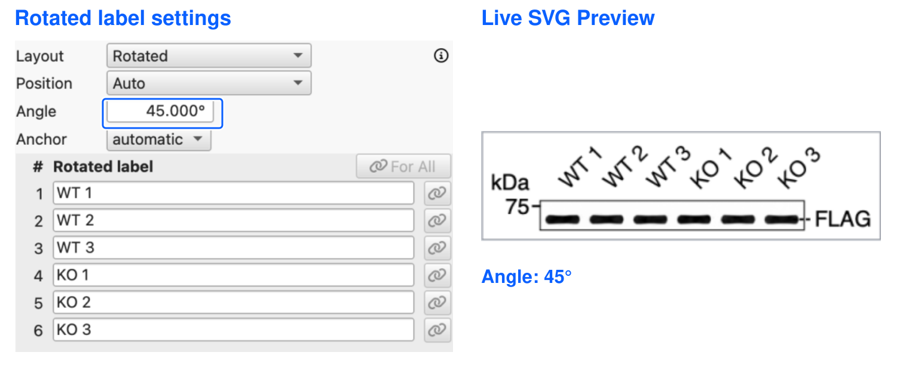

### Settings by layout

The table below shows which settings are available for each layout.

| Setting       | Basic         | Rotated       | Table (per lane) | Table (line span) | Table (bracket span) |
| ------------- | ------------- | ------------- | --------------------- | ---------------------- | ------------------------- |
| Position      | ✅️† | ✅️† | ✅️‡         | ✅️‡          | ✅️‡             |
| Angle         | ❌️             | ✅️             | ✅️§         | ✅️§          | ✅️§             |
| Anchor        | ❌️             | ✅️             | ❌️                     | ❌️                      | ❌️                         |
| Row gap       | ❌️             | ❌️             | ✅️¶         | ✅️¶          | ✅️¶             |
| Header gap    | ❌️             | ❌️             | ✅️                     | ✅️                      | ✅️                         |
| Header side   | ❌️             | ❌️             | ✅️                     | ✅️                      | ✅️                         |
| Header offset | ❌️             | ❌️             | ✅️§         | ✅️§          | ✅️§             |
| Line width    | ❌️             | ❌️             | ❌️                     | ✅️                      | ✅️                         |
| Line inset    | ❌️             | ❌️             | ❌️                     | ✅️                      | ✅️                         |
| Line offset   | ❌️             | ❌️             | ❌️                     | ✅️                      | ❌️                         |
| Hide lines    | ❌️             | ❌️             | ❌️                     | ✅️§          | ✅️§             |
| Text offset   | ❌️             | ❌️             | ❌️                     | ❌️                      | ✅️                         |

† With **Position** set to **Auto**, sample labels are placed above or below the blot based on the sample positions within the selected figure area. 
‡ With **Position** set to **Auto**, table rows can be placed both above and below the blot. See [Edit table layout](#edit-table-layout) for details. 
§ These settings appear when you click the gear icon for a row. 
¶ This setting is unavailable when there is only one row, or when two rows are split between the top and bottom of the blot.

### Reuse sample labels in another figure

Reuse sample-label text and layout settings in another MyWB document.

1. In the source document, open <picture><source media="(prefers-color-scheme: dark)" srcset="../assets/eye-solid_gray20.svg"></picture> **SVG Preview** and choose **Edit > Copy Sample Labels**.
2. Open the destination document and add sample positions if needed. Then open <picture><source media="(prefers-color-scheme: dark)" srcset="../assets/eye-solid_gray20.svg"></picture> **SVG Preview**.
3. Choose **Edit > Paste Sample Labels**.

To paste only the text or layout settings, use:

- **Edit > Paste Sample Label Text Only**
- **Edit > Paste Sample Label Style Only**

> [!NOTE]
> Copying and pasting use samples within the ROI's horizontal range, or all samples if there is no ROI. Labels are pasted in left-to-right order. If the sample counts or layouts differ, MyWB asks how to proceed.

To reuse figure-wide settings such as fonts and font sizes, use an [SVG Style preset](settings.md#svg-style-presets).

## Edit SVG style

The following settings can be edited:

- **Global:** margins and font family
- **Image†:** pixel width, pixel height, scale (%), [**Fit to Lanes**](#fit-to-lanes), and border width
- **Markers:** position, gap, font size, baseline offset, tick width, and tick length
- **Marker Unit:** the unit of the marker sizes, and its position, font size, angle, gap, and shift. See [Marker unit](#marker-unit).
- **Bands:** which band-table rows are named, the position, font size, and gap of the band names, and the style of their ticks. See [Band names and ticks](#band-names-and-ticks).
- **Labels‡:** position, font size, and gap
- **Details:** visibility, font size, and gap
- **Annotation:** one text for each of the four sides (**Left**, **Right**, **Top** and **Bottom**; an empty box draws nothing on that side), and the font size, gap, and text alignment they share

† **Pixel width**, **Pixel height**, and **Scale (%)** are linked to one another. 
‡ **Position** is linked to **Sample Label > Position**.

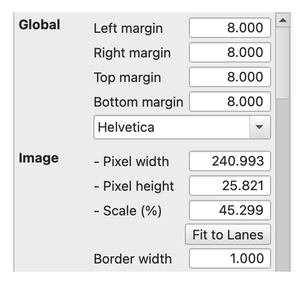

On the **SVG Style** tab, use the **...** menu to select **Load System Default**, **Toggle Previous Style**, or **Save Current Style As...**.

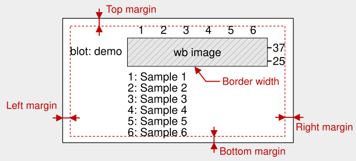

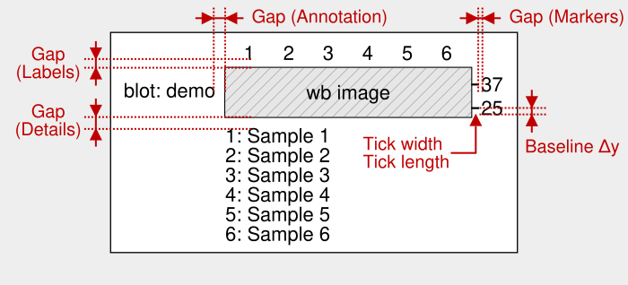

### Marker unit

Type the unit of the marker sizes, such as `kDa` or `bp`, once in **Unit** under **Marker Unit**. It is drawn beside the marker numbers, so the numbers themselves need no unit. The unit belongs to the document and is not part of an SVG Style preset; where it is drawn is.

- **Position:** **Above** or **Below** the marker numbers, or beside the picture at its **Top**, **Middle**, or **Bottom**.
- **Font size:** left empty, the unit is drawn at the markers' font size and follows it.
- **Angle**, **Gap**, and **Shift** turn and move it.

A marker label that has a unit of its own keeps it.

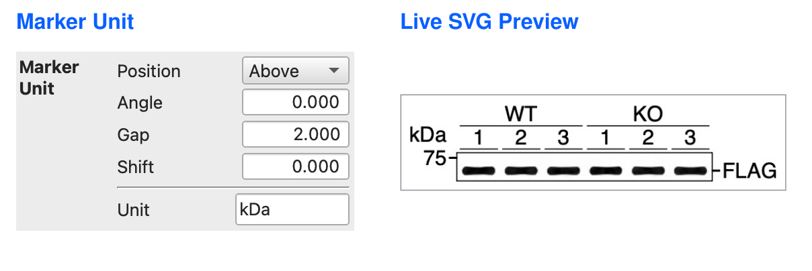

### Band names and ticks

The **Bands** section draws the names of the band-table rows beside the picture, each with a tick pointing at its band.

- The list of rows chooses which rows are named. **Show All** and **Hide All** tick or untick every row. Which rows are named belongs to the document, not to the SVG Style preset.
- **Position**, **Font size**, and **Gap** place the names.
- **Tick style** is **Solid**, **Dashed**, **← Left**, or **→ Right**. **Arrow size** and **Dash length** (in tick widths) appear only for the styles that use them. **Tick color** and **Tick width** set its colour and width.
- **Auto length**, on by default, draws the tick from the picture's edge to past the marker labels. Untick it to set **Tick length**, the tick's whole length from the picture's edge.
- **Tick inset** sets how far the tick reaches into the picture.

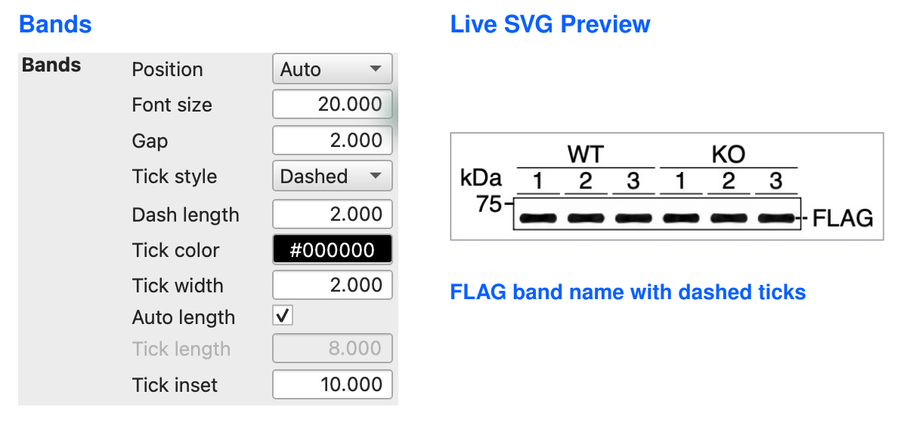

### Fit to Lanes

**Fit to Lanes**, under **Image** (also **SVG > Fit to Lanes**), sets **Scale (%)** in one press so that neighbouring sample lanes inside the ROI stand two sample-label font sizes apart, measured as the median gap between lanes. It needs at least two sample positions within the ROI, and is one step of **Edit > Undo**.

### Find a setting from the preview

- Move the mouse over the preview: the part of the figure under it is tinted. Click it to bring up what sets it: a sample's or marker's row in the label panel, a cell of a table layout, or its **SVG Style** section, tinted for a moment so that it is easy to find.
- Hovering a field or an **SVG Style** section tints the parts of the figure it sets.
- Parts that are not drawn at the moment, such as an empty annotation side, hidden details, or band names left out, are shown faintly where they would go. They appear in the preview only, never in what is saved or copied, and can be clicked like the rest.
- A zoomed-in preview stays zoomed as the figure changes, and pans to keep what you type in view.

## Continue with

- [Put panels together as an assembly](assemblies.md)
- [Save the editable MyWB file](manage-mywb-files.md#common-mywb-file-operations)
- [Copy the figure to PowerPoint](powerpoint-workflow.md#powerpoint-workflow)
- [Adjust marker and blot images](adjust-images.md)
