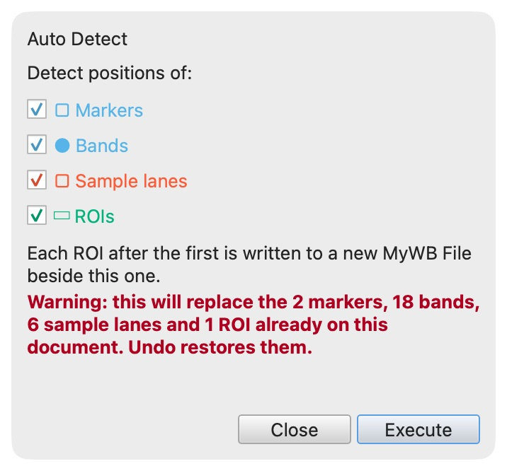
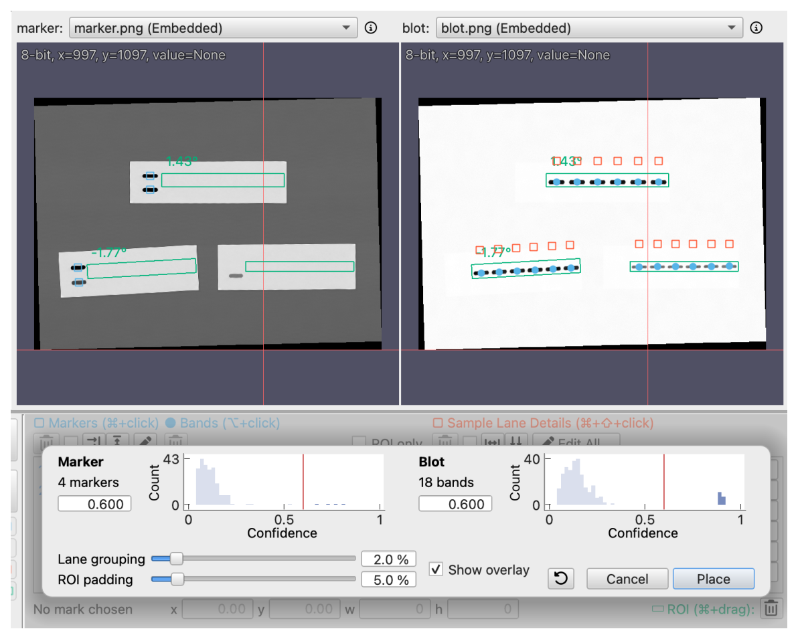
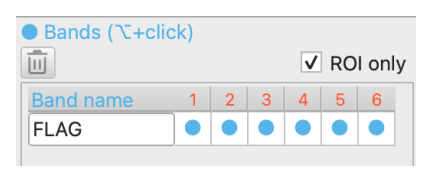

# Detect bands and use the band table

[← How to use MyWB](../user-guide.md)

**Auto Detect**  finds the bands in your images and places markers, bands, sample lanes and ROIs from them. The **band table** holds the bands of the document, laid out as the blot is. Adding, moving and editing bands yourself, including in the band table, is a Basic feature; only Auto Detect needs Premium Access.

Auto Detect runs entirely on your computer. No image and nothing about the document leaves it.

## Before you start

- [Open the blot image](open-images.md), and the marker image if you want marker positions found.

## Run Auto Detect

1. Click **Auto Detect**, to the left of the tables under the picture (also **Marker/Blot > Auto Detect...**).
2. Under **Detect positions of:**, choose what to find. Each one replaces what the document already has of that kind:
    - **Markers:** the ladder on the marker image, with a marker position on each rung. The rows are left without sizes; your [Auto Fill preset](settings.md#auto-fill-presets) fills them.
    - **Bands:** the bands on the blot image, put into the band table. With several [channels](fluorescent-channels.md), there is a box for each channel.
    - **Sample lanes:** the bands grouped into lanes, with one sample position at the head of each lane. Quantification counts its lanes from these.
    - **ROIs:** an ROI fitted around each group of lanes, levelled: one for each membrane, and two where a ladder stands between lanes. Each ROI after the first is saved to a new MyWB file beside the document.

    A choice the document cannot answer is greyed, and the window says which image is missing. What MyWB would replace is shown above **Execute**.
3. Click **Execute**. A progress bar follows the run; **Cancel** stops it at once and places nothing.

If the run finds nothing, the window says so.

## Check the result and place it

When the run finds something, nothing is placed yet. What it found is drawn over the pictures, and a panel over the tables shows how to adjust it.

- **Confidence threshold:** for each image, a histogram shows how confident the model is in each band. Drag the threshold line, or type a value, to keep fewer or more bands. The pictures and the count follow at once, without running the model again.
- **Lane grouping** (with Sample lanes ticked) sets how far apart two bands may sit and still be one lane.
- **ROI padding** (with ROIs ticked) sets how far each ROI reaches past the top and bottom of its bands.
- Untick **Show overlay** for a clear look at the picture. The <picture><source media="(prefers-color-scheme: dark)" srcset="../assets/rotate-left-solid_gray20.svg"></picture> circular-arrow button beside **Cancel** puts the threshold and sliders back.
- You can still zoom and change the contrast while you look.

Click **Place** to put down what is drawn, as one step of **Edit > Undo**. **Cancel**, <kbd>Esc</kbd>, or leaving for another page or document asks first, because getting the result back means detecting again.

> [!NOTE]
> If Auto Detect creates multiple ROIs, each ROI after the first is saved as a separate MyWB file beside the current document. **Edit > Undo** reverses the changes to the current document, but the new files remain.

> [!TIP]
> Missing bands is how the model usually fails. Before you place the result, compare the drawn bands with the picture, and lower the threshold if bands you can see are left out.

## Use the band table

The band table, between **Markers** and **Sample Lane Details** under the picture, is laid out as the blot is: a column for each lane, a row for each target, and one band to a cell. The name you type beside a row is the band name drawn in the figure (see [Band names and ticks](design-and-preview-figure.md#band-names-and-ticks)).

- **Add a band:** <kbd>Option</kbd>-click (macOS) or <kbd>Alt</kbd>-click (Windows) on the blot picture. The marker picture takes no bands.
- **Move a band:** drag it on the picture, or type its **x** and **y** in the boxes under the tables. Its cell follows.
- **Rearrange the table:** drag a band to an empty cell to put it in that lane and row without moving it on the picture. Drop it on the line between two columns or two rows to give it a lane or a row of its own. Cells that would not take it are dimmed while you drag.
- **Choose bands:** click a band; <kbd>Shift</kbd>-click chooses a range, and <kbd>Command</kbd>-click (macOS) or <kbd>Ctrl</kbd>-click (Windows) adds or removes one. A row's name chooses the row's bands, and the **Band name** heading chooses every band. On the picture, <kbd>Shift</kbd>-click adds a band to the choice or takes it away.
- **Delete bands:** click the <picture><source media="(prefers-color-scheme: dark)" srcset="../assets/trash-can-regular_gray20.svg"></picture> trash-can button, or choose **Marker/Blot > Bands > Delete Selected Bands**.
- **ROI only** (also **Marker/Blot > Bands > Show Only Bands in ROI**) shows only the bands inside the ROI. A band whose centre lies outside the ROI is greyed in its cell.

With several [channels](fluorescent-channels.md), each band belongs to a channel, and a row never mixes channels.

Adding, moving, deleting and naming bands are each one step of **Edit > Undo**.

## Show and hide marks on the pictures

Under **Auto Detect**, a switch for each kind of mark (markers, bands, sample lanes and the ROI) takes it off the marker picture or the blot picture, and puts it back. A hidden kind is drawn grey and struck through. <kbd>Option</kbd>-click (macOS) or <kbd>Alt</kbd>-click (Windows) sets both pictures at once, and the button above the switches reads **Hide All** or **Show All**.

Only the screen changes: the figure, the export and the saved file keep every mark. A hidden mark takes no clicks or drags.

## Level the picture by the ROI

**Auto**, beside the rotate buttons, turns the picture so that the bands inside the ROI run level, by up to 10° either way. The markers, sample lanes, bands and ROI turn with it. It needs an ROI, says so when no angle can be read, and is one step of **Edit > Undo**. It is a Basic feature.

## Continue with

- [Quantify bands](quantify-bands.md)
- [Edit sample labels](design-and-preview-figure.md#edit-sample-labels)
- [Show a fluorescent blot's channels](fluorescent-channels.md)
