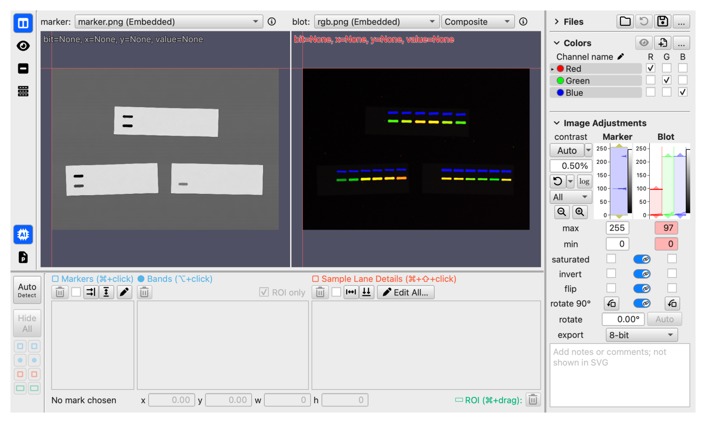
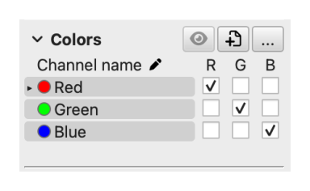
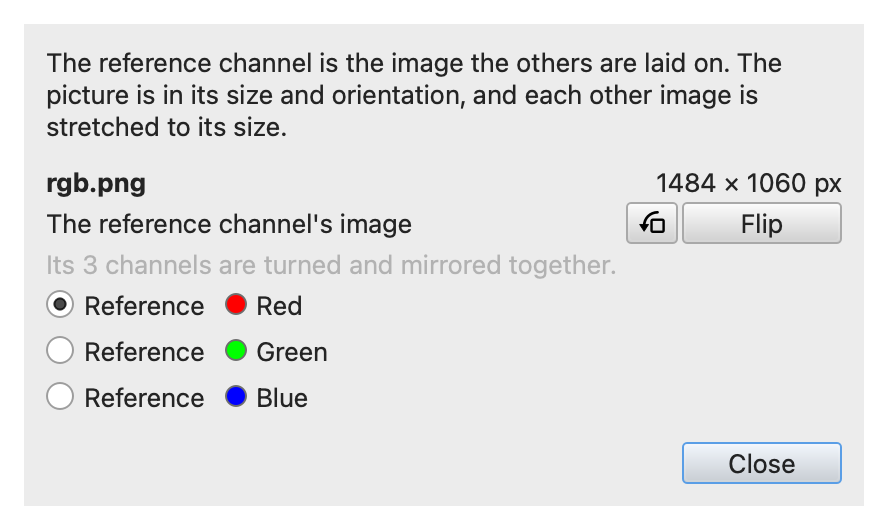

# Show a fluorescent blot's channels

[← How to use MyWB](../user-guide.md)

A fluorescent blot is often imaged in several channels: one colour image, or a separate grayscale file for each channel. MyWB can hold them all as the Blot's channels, draw them together in their colours as **Composite**, and detect, quantify and label the bands of each channel.

## Open the channels

- **From one colour image:** [open it as the blot](open-images.md#open-a-marker-or-blot-image) and choose **Composite** in **Select RGB channels**. Its red, green and blue become the Blot's channels.
- **From separate files:** open the first file as the blot, then add each of the others with **Add channel image...** in the Blot's channel list (also **Marker/Blot > Blot Channel > Add Channel Image...**). An image of another size is stretched to the size of the [reference channel](#choose-the-reference-channel); MyWB asks first when its proportions differ.

The Blot's channel list switches between **Composite** and showing one channel at a time.

## Set the channels' colours, names and visibility

While the Blot has several channels, the **Colors** section beside the pictures lists them.

- **R**, **G** and **B:** the ticks in a channel's row are its colour. Green alone draws it in green; red and blue together draw it in magenta. The colours are saved with the document.
- **Shown channels:** select rows to choose which channels the Blot pane shows. <picture><source media="(prefers-color-scheme: dark)" srcset="../assets/eye-solid_gray20.svg"></picture> **Show all channels** shows every channel again.
- **The marked channel** is the one the Blot's controls (contrast, invert) and new bands are about. The Blot's histogram has a bar and a curve for each channel.
- <picture><source media="(prefers-color-scheme: dark)" srcset="../assets/pen-solid_gray20.svg"></picture> **Channel Names...** names the channels (for example `p-ERK` and `GAPDH`). The names are used on the Quantification tabs and in the results.
- <picture><source media="(prefers-color-scheme: dark)" srcset="../assets/file-regular_plus_gray20.svg"></picture> **Add a channel image...** adds another file as a channel.
- The **...** menu has **Channel Settings...** and **Delete Selected Channels...**.

## Choose the reference channel

One channel is the reference: the image the others are laid on. The picture, the ROI, the labels and the bands are all in its size and orientation. Every other image is turned and mirrored as its file needs, then stretched to the reference's size.

1. In the **Colors** section, open the **...** menu and choose **Channel Settings...**.
2. Select **Reference** beside the channel to use as the reference. The ROI, labels and bands are carried over to it.
3. If the image of another file lies another way, turn or mirror that file with its buttons. The channels of one file always lie alike.

Each choice takes effect as you make it, and **Edit > Undo** takes it back.

## Bands, Auto Detect and Quantification

- **Bands belong to a channel.** New bands go to the marked channel, and a row of the band table never mixes channels.
- **Auto Detect**  has a box for each channel under **Bands**, and a tab for each channel on its sheet. **Place** replaces only the bands of the channels it looked in.
- **[Quantification](quantify-bands.md)**  measures every channel with one set of lanes and shows one channel at a time on tabs. **Copy Results** and **Export Results** give a `Channel` column and a row for each lane of each channel; **Export Results** writes one graph for each channel.

## A ladder photographed in colour

If the marker image is a colour photograph of the ladder (rungs of some sizes in red, for example), choose **Color** in the Marker's channel list. Red, green and blue are each drawn in their colour, at the one contrast and Invert of the Marker's controls. This changes only how the Marker is seen; the figure does not draw the marker image.

## Continue with

- [Adjust marker and blot images](adjust-images.md)
- [Quantify bands](quantify-bands.md)
- [Put panels together as an assembly](assemblies.md)
