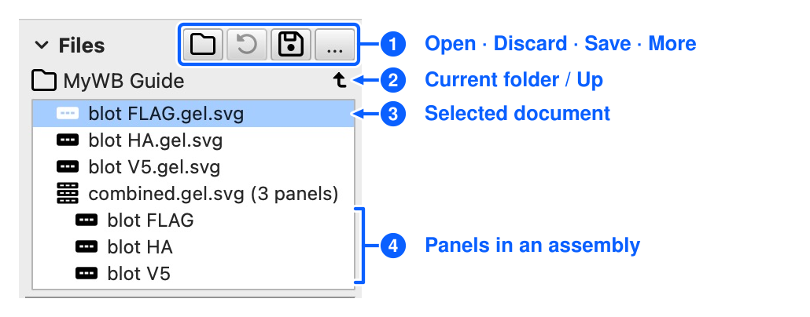
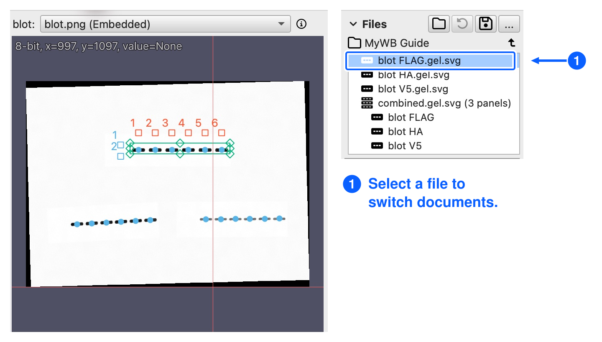
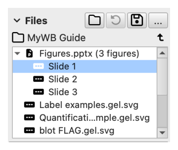

# Manage MyWB files

[← How to use MyWB](../user-guide.md)

Use the **Files** panel on the right side of the window to create, open, save, and organize editable `.gel.svg` files. It also lists the panels of a GelSVG file of several panels, and the MyWB figures in the folder's PowerPoint files.

## Common MyWB file operations

| Operation                  | Toolbar / button                                             | File menu                                           | Keyboard shortcut                                            | Other                                                        |
| -------------------------- | ------------------------------------------------------------ | --------------------------------------------------- | ------------------------------------------------------------ | ------------------------------------------------------------ |
| **Start a New MyWB File**  | **…** menu                                                   | **File > New MyWB File**                            | <kbd>Command+N</kbd> (macOS) <kbd>Ctrl+N</kbd> (Windows) | —                                                            |
| **Open** | <picture><source media="(prefers-color-scheme: dark)" srcset="../assets/folder-regular_gray20.svg"></picture> **Open** | **File > Open MyWB File** **File > Open Recent** | <kbd>Command+O</kbd> (macOS) <kbd>Ctrl+O</kbd> (Windows)  | Drag a MyWB file onto the MyWB window                        |
| **Open a PowerPoint file**  | Click a `.pptx` file in the **Files** panel | **File > Open MyWB File** | <kbd>Command+O</kbd> (macOS) <kbd>Ctrl+O</kbd> (Windows) | Drag a PowerPoint file onto the MyWB window |
| **Save** | <picture><source media="(prefers-color-scheme: dark)" srcset="../assets/floppy-disk-regular_gray20.svg"></picture> **Save** | **File > Save MyWB File**                           | <kbd>Command+S</kbd> (macOS) <kbd>Ctrl+S</kbd> (Windows)  | —                                                            |
| **Save As**                | **…** menu                                                   | **File > Save MyWB File As...**                     | <kbd>Command+Shift+S</kbd> (macOS) <kbd>Ctrl+Shift+S</kbd> (Windows) | —                                                            |
| **Save All**               | **…** menu                                                   | **File > Save All MyWB Files**                      | —                                                            | —                                                            |
| **Discard Changes**        | <picture><source media="(prefers-color-scheme: dark)" srcset="../assets/rotate-left-solid_gray20.svg"></picture> **Discard Changes** | **File > Discard Selected MyWB File Changes...**    | —                                                            | —                                                            |
| **Duplicate**              | **…** menu                                                   | **File > Duplicate MyWB File**                      | —                                                            | —                                                            |
| **Rename**                 | **…** menu                                                   | **File > Rename MyWB File...**                      | —                                                            | In the **Files** panel, select a file and press <kbd>Enter</kbd> |
| **Move to Trash**          | **…** menu                                                   | **File > Move MyWB File to Trash...**               | —                                                            | —                                                            |

## GelSVG files

MyWB saves documents as **GelSVG** (`.gel.svg`), an open format for gel and blot figures. A GelSVG file is an ordinary SVG figure, so it can be placed in PowerPoint, Illustrator, or a web page like any other picture, and its picture also holds the document: the source images and their file metadata, the ROI, orientation and contrast, labels, and bands.

- The GelSVG specification is still a draft, to be published as GelSVG 1.0. Until then MyWB saves the draft, GelSVG 0.1; a later MyWB will open these files and save them as 1.0.
- To look at a GelSVG file without MyWB, open the [GelSVG viewer](https://gelsvg.github.io/) in a web browser. The file is read in the browser and never uploaded.
- A GelSVG file holding something this version of MyWB cannot keep yet, such as band detection records, a newer version of the format, or channels laid out in a way MyWB cannot hold, is not opened. MyWB says why and offers the GelSVG viewer.
- MyWB 0.6 and earlier cannot open `.gel.svg` files.

### Files from earlier versions

MyWB still opens files saved by earlier versions (`.mywb.svg`, `.my_wb.svg`, and `.wb`) but does not write over them. **Save** opens **Save As** with `<name>.gel.svg` beside the old file, and the old file stays as it was. **Save All** does the same for each of them. If you used an earlier version of MyWB, it tells you this once, before your first save; it tells you also when the first file you save is one of these old files. **Cancel** there stops the save, and you are told again next time; **Continue** saves, and you are not told again. **Help > Reset “Do Not Show Again” Choices…** brings it back.

## Find a source image

Open the MyWB document and switch to <picture><source media="(prefers-color-scheme: dark)" srcset="../assets/table-columns-solid_gray20.svg"></picture> **Marker/blot view**.

1. Choose **File > Find Blot Source Image...** or **File > Find Marker Source Image...**.
2. Select a folder and how many levels of subfolders to search, then click **Search**.
3. Use **Show in Finder** (macOS) or **Show in File Explorer** (Windows) beside a result to locate the file.

Files are matched by their contents, so renamed copies can be found. The search only lists matching files; it does not change the document.

The command is unavailable if MyWB already knows the file's location or the document lacks the information needed to identify it.

To rebuild a source image file from the document, see [Export a source image](export-cropped-image.md#export-a-source-image).

## Use the Files panel

### Files in a folder

When you open or save a MyWB file, the **Files** panel shows the current file and any other MyWB files (`.gel.svg`, and files from earlier versions) in the same folder.

- The current folder name appears beside the <picture><source media="(prefers-color-scheme: dark)" srcset="../assets/folder-regular_gray20.svg"></picture> folder icon above the list.
- The highlighted row is the document currently displayed in MyWB.
- An asterisk (`*`) before a name indicates changes that have not yet been saved.
- Select a file in the list to display it.

The **Files** panel is especially useful when multiple membranes are captured in a single source image. Save a separate `.gel.svg` file for each membrane in the same folder, and you can switch between their saved ROIs, labels, image adjustments, and figure layouts by selecting a file in the panel.

### Figures in PowerPoint files

The panel lists the `.pptx` files in a folder beside its MyWB files. Click one to list the MyWB figures in it, named by slide; a figure of several panels lists its panels under it.

- MyWB never changes the PowerPoint file. A figure you edit is marked with `*` until you save it with **Save As** as a `.gel.svg` file.
- For details, see [Use MyWB with PowerPoint](powerpoint-workflow.md#powerpoint-workflow).

## Add notes to a MyWB file

Use the note field at the bottom of the right control panel to save free-form notes, such as sample provenance or a lab notebook number, with the current `.gel.svg` file. The notes are restored when the file is reopened but do not appear in the figure. To display text in the figure, use an [annotation](design-and-preview-figure.md#edit-svg-style) instead.

## Continue with

- [Preview and adjust the figure](design-and-preview-figure.md)
- [Use the figure in PowerPoint](powerpoint-workflow.md)
- [Quantify bands](quantify-bands.md) 
